# Guía de uso · MASH Check

Paso a paso para quien la usa por primera vez. Las capturas son de una empresa de ejemplo
("Planta Demo") con datos inventados.

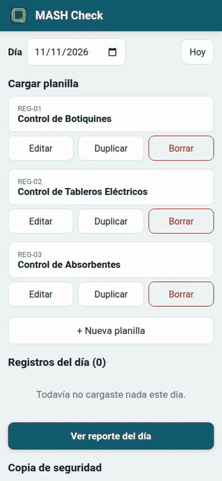

> También hay un [video de 2 minutos y medio](video/mash-check-demo.mp4) con todo el recorrido.

**Contenido**

1. [Abrirla e instalarla](#1-abrirla-e-instalarla)
2. [La pantalla de inicio](#2-la-pantalla-de-inicio)
3. [Cargar una planilla](#3-cargar-una-planilla)
4. [Los registros del día](#4-los-registros-del-día)
5. [El reporte del día](#5-el-reporte-del-día)
6. [Exportar el PDF (del día o de una sola planilla)](#6-exportar-el-pdf-del-día-o-de-una-sola-planilla)
7. [Compartir el resumen](#7-compartir-el-resumen)
8. [Armar tus propias planillas](#8-armar-tus-propias-planillas)
9. [Empresa, logo y copia de seguridad](#9-empresa-logo-y-copia-de-seguridad)
10. [Preguntas frecuentes](#10-preguntas-frecuentes)

---

## 1. Abrirla e instalarla

Abrí **https://roca-byte.github.io/mash-check/**. No hace falta cuenta.

Para tenerla como una app: en **Android (Chrome)**, menú ⋮ → *Instalar app*; en **iPhone
(Safari)**, Compartir → *Agregar a inicio*. Después de abrirla una vez, funciona sin señal.

## 2. La pantalla de inicio

- Arriba, el **Día**: abre en el de hoy. Si elegís otro, ves lo que cargaste ese día; **Hoy**
  te vuelve al de hoy.
- **Cargar planilla**: un botón grande por planilla. Vienen tres listas para usar
  (Botiquines, Tableros eléctricos y Absorbentes) y podés armar las tuyas.
- Debajo de cada planilla: **Editar**, **Duplicar** y **Borrar** (ver
  [sección 8](#8-armar-tus-propias-planillas)).

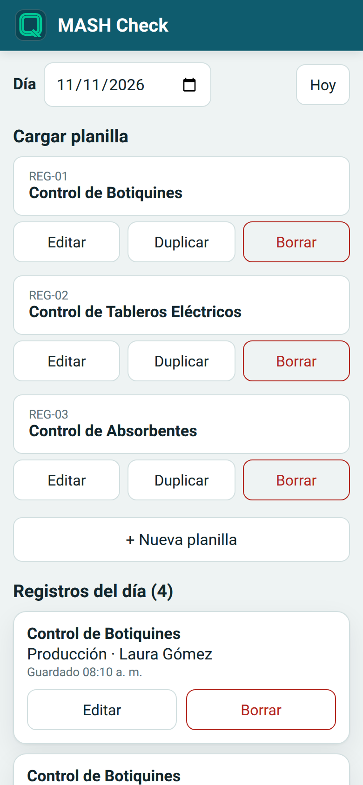

## 3. Cargar una planilla

1. Tocá la planilla que vas a controlar (por ejemplo **Control de Botiquines**).
2. Completá los datos de arriba. En Botiquines elegís el **puesto**: se carga un registro por
   puesto. En **Revisó** aparece solo el último nombre que usaste.
3. Respondé cada ítem con los botones grandes (se usan con guantes):
   - **Sí / No**: la respuesta que hay que atender se pinta de **rojo** (en "Disponible" es
     el No; en "Recargar" es el Sí).
   - **Bien / Mal**: "Mal" siempre es para atender.
   - **Realizado**: una tilde para los trabajos hechos.
   - Las columnas de texto (observaciones, acción a realizar, responsable) se escriben.
   - Tocá de nuevo una respuesta para borrarla.
4. Tocá **Guardar**: está siempre abajo, aunque la planilla sea larga. **Cancelar** te pide
   confirmación para no perder lo cargado.

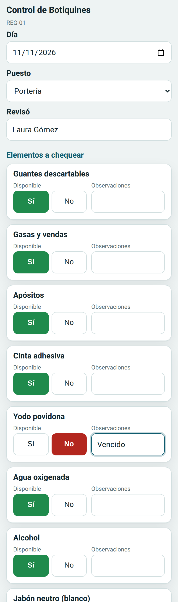 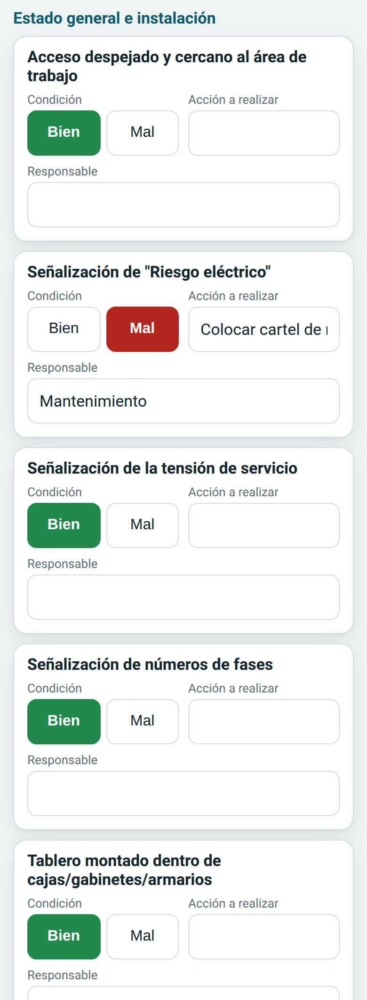

## 4. Los registros del día

Debajo de las planillas está la lista de lo que cargaste ese día, con la hora en que se
guardó. Podés **Editar** o **Borrar** cada registro.

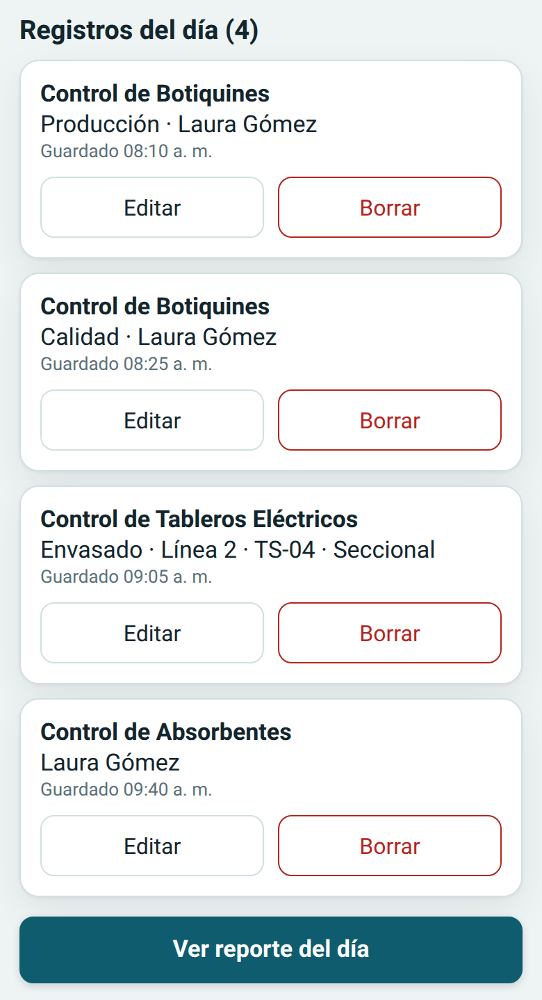

Si después cambiás una planilla, los registros que ya cargaste **no se modifican**: cada uno
guarda la planilla tal como era ese día.

## 5. El reporte del día

Tocá **Ver reporte del día**. Arriba, el encabezado con tu logo (o el nombre de la empresa),
la fecha, cuántas planillas cargaste y quién controló. Después:

- **Ítems a atender**: cada respuesta en rojo, con la planilla, el puesto o sector, el ítem y
  lo que escribiste en esa fila (observaciones, acción, responsable).
- **Sin responder**: cuántas casillas Sí/No o Bien/Mal quedaron vacías en cada planilla (las
  de "Realizado" no cuentan: no tildarla quiere decir que no se hizo).
- **Detalle**: cada planilla completa, en tablas. En el celular, las tablas anchas se deslizan
  de costado.

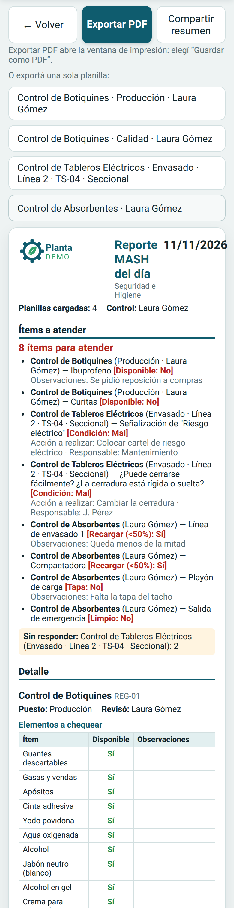

## 6. Exportar el PDF (del día o de una sola planilla)

**Exportar PDF** abre la ventana de impresión del celular: elegí **Guardar como PDF**. Sale
en hoja A4, sin los botones de la app. El archivo se propone con la fecha, por ejemplo
*MASH Reporte del día 11-11-2026*.

Si cargaste varias planillas, el PDF del día puede quedar largo. Debajo de los botones
aparece **O exportá una sola planilla**: tocá la que quieras y la app muestra el reporte
**solo de esa** (con sus propios ítems a atender) y abre la impresión. El archivo sale con el
nombre de la planilla y la fecha. Para volver al reporte completo, tocá **← Ver todo el día**.

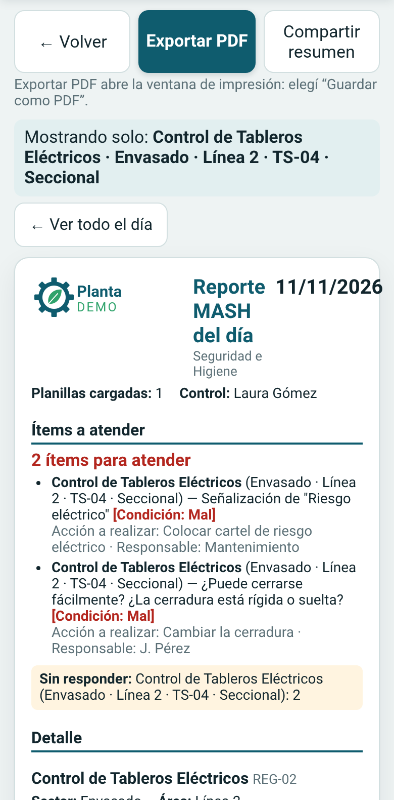

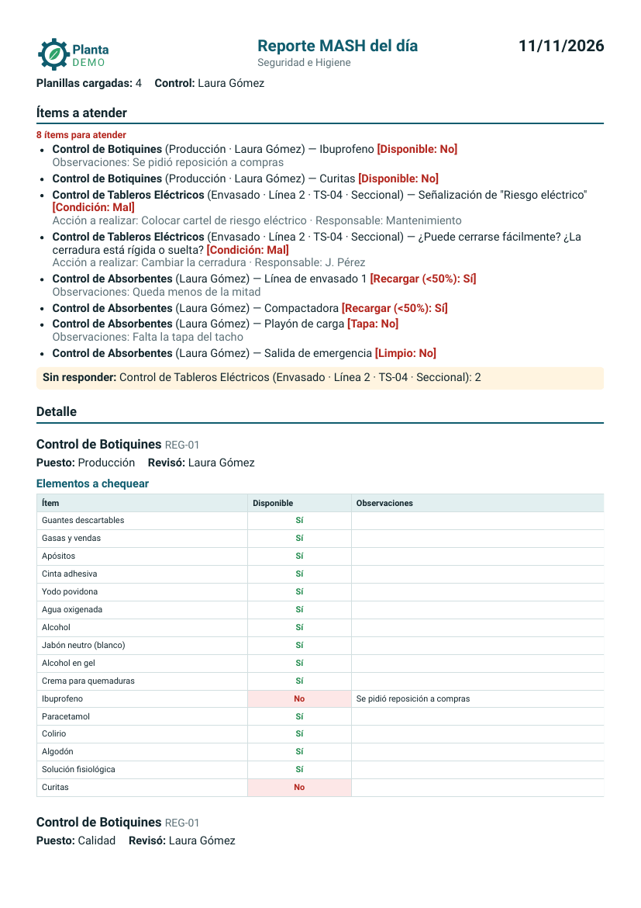 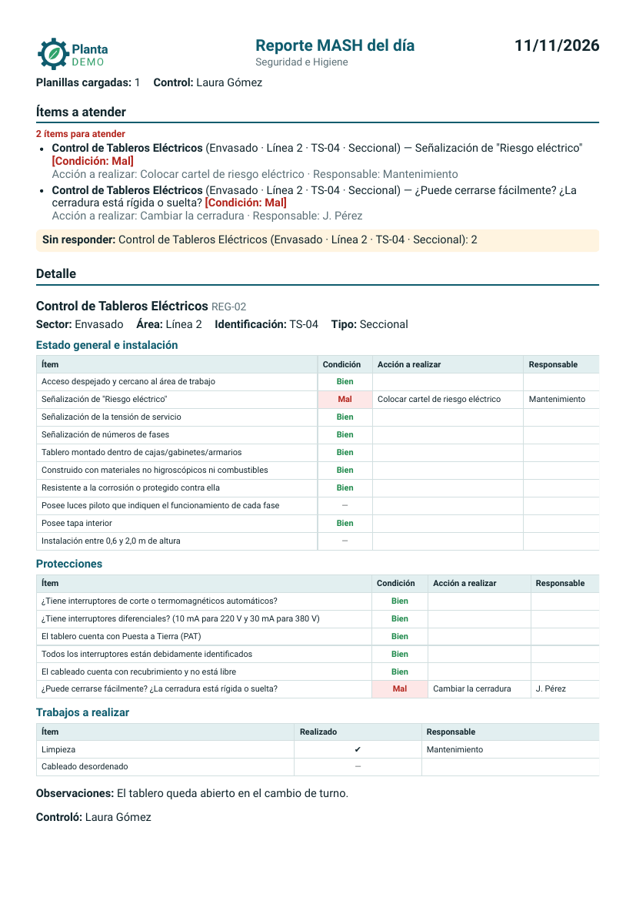

## 7. Compartir el resumen

**Compartir resumen** abre el menú de compartir del celular (WhatsApp, mail…) con un texto
corto: cada planilla con cuántos ítems hay para atender y cuáles son. Si estás viendo una
sola planilla, comparte solo esa. Si el celular no tiene ese menú, la app copia el texto para
que lo pegues donde quieras.

## 8. Armar tus propias planillas

Tocá **+ Nueva planilla** (o **Editar** en una que ya existe):

1. **Título** y **código** (el código es opcional).
2. **Datos de arriba**: los campos de la cabecera (por ejemplo *Sector*), de texto libre o
   para elegir de una lista. "Revisó" ya viene puesto y recuerda tu nombre.
3. **Secciones**: cada una con sus **columnas** (Sí/No, Bien/Mal, Tilde o Texto) y sus
   **ítems, uno por línea**. En las columnas Sí/No elegís qué respuesta es un problema (*En el
   reporte, atender si responde*).
4. Si querés, un **cuadro de observaciones** al final y **datos del final** (por ejemplo
   *Controló*).
5. **Guardar planilla**.

Con **▲ ▼** cambiás el orden y con **✕** quitás. **Duplicar** abre una copia para editar (no
se crea hasta que la guardás). **Borrar** una planilla no borra los registros que ya cargaste
con ella. Si borrás todas, aparece el botón para **restaurar las de fábrica**.

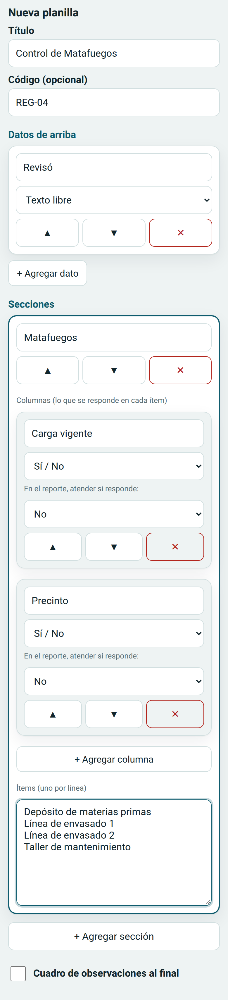

## 9. Empresa, logo y copia de seguridad

Al final de la pantalla de inicio:

- **Copia de seguridad**: **Descargar respaldo** baja un archivo con todo (registros y
  planillas). **Restaurar respaldo** lo vuelve a cargar: te dice cuántos registros y planillas
  tiene y, si confirmás, **reemplaza** todo lo que hay en el celular. Un archivo de otra app no
  se acepta.
- **Empresa**: el nombre y el logo que van en el encabezado del reporte. Si cargás logo, se
  muestra el logo; si no, el nombre.

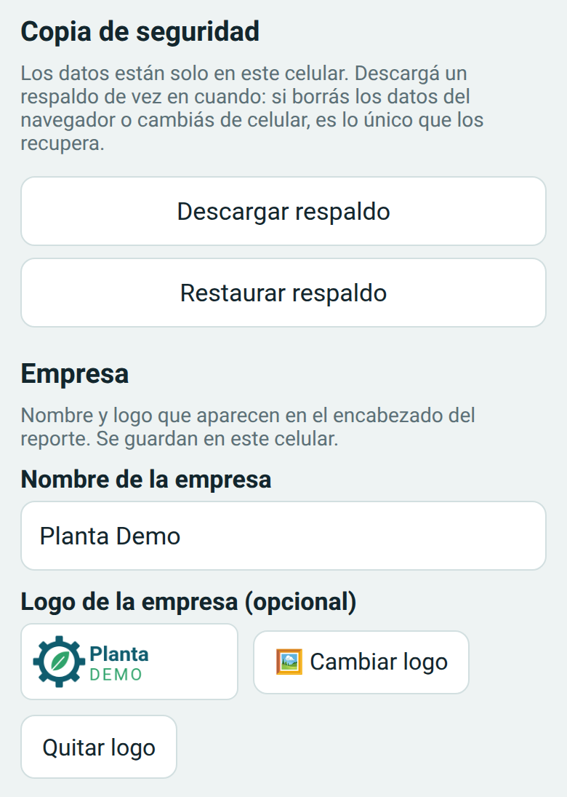

Al pie de todo se ve la **versión** de la app que tiene tu celular.

## 10. Preguntas frecuentes

**¿Funciona sin señal?**
Sí. Después de abrirla una vez con internet, carga, guarda y arma el reporte sin conexión.

**¿Dónde quedan mis datos?**
Solo en tu celular. No hay cuentas ni servidor: nadie más los ve.

**¿Puedo perder lo que cargué?**
Si borrás los datos del navegador o cambiás de celular, sí. Descargá un **respaldo** seguido
y guardalo fuera del celular (en el mail o en la nube).

**¿Cómo cargo un control de otro día?**
Elegí el día arriba en la pantalla de inicio antes de tocar la planilla, o cambiá el **Día**
dentro del formulario.

**¿Se puede usar en la compu?**
Sí, en cualquier navegador. Está pensada para el celular, porque se usa en la recorrida.
